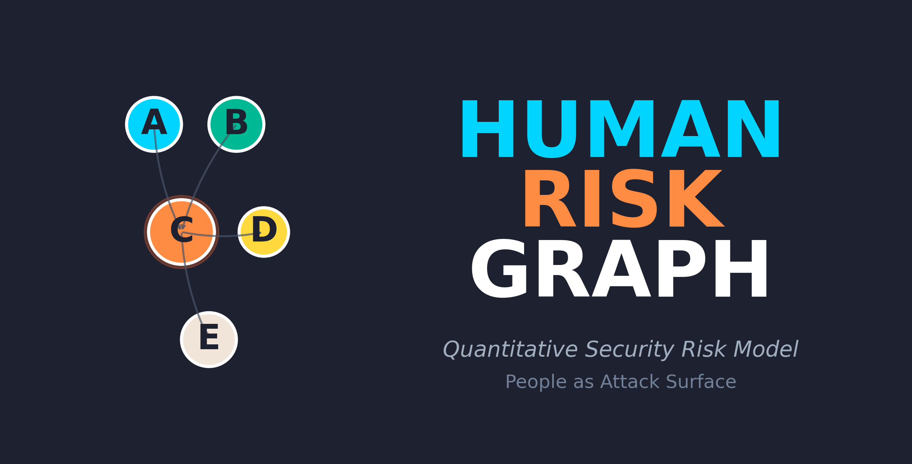

<p align="center">
  
</p>

<p align="center">
  <a href="https://pypi.org/project/human-risk-graph/">
    
  </a>
  <a href="https://pypi.org/project/human-risk-graph/">
    
  </a>
  <a href="https://doi.org/10.5281/zenodo.18288055">
    
  </a>
  <a href="https://github.com/LF3551/human-risk-graph/actions/workflows/ci.yml">
    
  </a>
  <a href="https://codecov.io/gh/LF3551/human-risk-graph">
    
  </a>
  <a href="https://github.com/LF3551/human-risk-graph/blob/main/LICENSE">
    
  </a>
  <a href="https://www.python.org/downloads/">
    
  </a>
  <a href="https://github.com/psf/black">
    
  </a>
  <a href="https://scorecard.dev/viewer/?uri=github.com/LF3551/human-risk-graph">
    
  </a>
  <a href="https://bestpractices.coreinfrastructure.org/projects/12048">
    
  </a>
</p>

# Human Risk Graph (HRG)

Human Risk Graph (HRG) is a quantitative model for measuring organizational
security risk caused by human dependencies, decision concentration,
and bus-factor effects.

Unlike traditional security models that focus only on technical assets,
HRG treats people as part of the attack surface and models how organizational
decisions and emergency processes introduce systemic risk.

## Core Idea

Organizations often depend on a small number of individuals for:
- critical decisions,
- emergency bypasses,
- access approvals.

HRG represents these dependencies as a directed graph and computes
risk metrics that highlight human single points of failure.

## What HRG Measures

The result is a **score from 0 to 100 with a grade from A to F**, built from three metrics
(model `hrg-2`, see [docs/model.md](docs/model.md)):

- **Key-person risk** — how much of the organization depends on one person: losing them
  cuts off N people and X% of the connections between the others. Also reported as the
  classic **bus factor**.
- **Approval concentration** — the **effective number of approvers** (Herfindahl-Hirschman
  index): one person approving everything is as concentrated as it gets.
- **Override exposure** — the share of critical approvals someone can override through a
  bypass.

On top of the score, HRG simulates remediations (a deputy for a key person, a second-person
check on a bypass) and tells you **which three fixes raise the score most**.

The original model from the paper is still available as `--model hrg-1`.

## Repository Structure

- `src/human_risk_graph/` — core implementation (HRG class, metrics, graph algorithms)
- `tests/` — comprehensive unit tests
- `experiments/` — synthetic data generation and benchmarking
- `examples/` — usage demonstrations
- `paper/` — LaTeX source of the [paper](https://doi.org/10.5281/zenodo.20260930)
- `docs/` — formal model with mathematical definitions
- `data/` — example organization datasets

## Quick Start

### Installation

```bash
# Install from PyPI (recommended)
pip install human-risk-graph

# Or install from source
git clone https://github.com/LF3551/human-risk-graph.git
cd human-risk-graph
pip install -e .

# With development tools
pip install -e ".[dev]"
```

### Data Format

Describe your organization in a JSON or YAML file:

```json
{
  "$schema": "https://raw.githubusercontent.com/LF3551/human-risk-graph/main/src/human_risk_graph/organization.schema.json",
  "people": [
    { "id": "A", "role": "SRE", "criticality": 0.9 },
    { "id": "B", "role": "Security Engineer", "criticality": 0.8 },
    { "id": "C", "role": "Manager", "criticality": 0.7 },
    { "id": "D", "role": "Developer", "criticality": 0.4 }
  ],
  "dependencies": [
    { "from": "A", "to": "B", "type": "approval", "weight": 0.8 },
    { "from": "C", "to": "A", "type": "bypass", "weight": 0.9 }
  ]
}
```

**Fields:**
- `people.id` — unique identifier
- `people.role` — job title (optional)
- `people.criticality` — importance level (0.0-1.0)
- `dependencies.from/to` — person IDs
- `dependencies.type` — relationship type (approval, bypass, etc.)
- `dependencies.weight` — dependency strength (0.0-1.0)

Invalid input (duplicate or unknown IDs, values outside 0.0-1.0) is rejected with an error
that points to the offending entry.

**YAML and editor support:** files ending in `.yaml` or `.yml` are read as YAML
(see [examples/organization.yaml](examples/organization.yaml)). The
[JSON Schema](src/human_risk_graph/organization.schema.json) gives completion and
validation in editors: reference it with `"$schema"` in JSON, or with
`# yaml-language-server: $schema=<url>` at the top of a YAML file.
`hrg schema` prints the schema.

### CLI Usage

The easiest way to use HRG is through the command-line interface:

```bash
# Analyze an organization (generates JSON, Markdown, and HTML reports)
hrg analyze data/example_organization.json

# Generate only HTML report
hrg analyze data/example_organization.json --format html

# Specify output file
hrg analyze data/example_organization.json --format html --output my_report.html

# CI: SARIF and JUnit reports, fail if the score is below 70
hrg analyze examples/organization.yaml --format sarif --format junit --no-visualize --min-score 70

# Compare two snapshots (text, markdown or json)
hrg diff org-q1.yaml org-q2.yaml --format markdown

# Original model from the paper, no fix plan, only errors
hrg analyze data/example_organization.json --model hrg-1 --fixes 0 --quiet

# Generate interactive graph visualization only
hrg visualize data/example_organization.json
```

Exit codes: `0` success, `1` invalid input or error, `2` usage error,
`3` score below `--min-score`, composite risk above `--fail-above`, or risk increased with
`hrg diff --fail-on-increase`.

### Example Output

```
Human Risk Graph 0.6.0 · example_organization.json · 10 people · 14 dependencies

  Score  61/100  ██████░░░░  D · Moderate risk  model hrg-2

  Key people  bus factor 1 · losing Johan Lindberg cuts off 2 people (39% of connections)
  Approvals   3.5 effective approvers of 5 · Luca Rossi holds 44%
  Overrides   4 of 7 critical approvals can be overridden

  Top fixes
  1  Require a second person for Elena Popescu's bypass of Anna Mueller  61 → 70  +9
  2  Add a deputy for Johan Lindberg                                     70 → 76  +6
  3  Add a deputy for Ines Silva                                         76 → 81  +5

  Findings  0 errors · 6 warnings
   △ HRG001 Ines Silva (ines.silva) is a single point of failure (criticality 0.55): losing them cuts
            off 1 person and 22% of the connections between the others.
   △ HRG001 Johan Lindberg (johan.lindberg) is a single point of failure (criticality 0.58): losing them
            cuts off 2 people and 39% of the connections between the others.
   △ HRG002 Approval authority is concentrated (3.5 effective approvers of 5); Luca Rossi (luca.rossi)
            holds 44% of the approval weight.
   △ HRG003 Elena Popescu (elena.popescu) can bypass Anna Mueller (anna.mueller) and override the
            controls they enforce; one of them is critical.
   ...

  Reports
   data/example_organization_report.json
   data/example_organization_report.md
   data/example_organization_report.html
   data/example_organization_graph.html
```

**Generated files:**
- JSON report with detailed metrics
- Interactive HTML graph visualization
- Optional Markdown and HTML reports

### HTML Report

One self-contained file that works offline, in light and dark mode, on a phone and as a PDF:
score and verdict, fix plan, interactive dependency map, people, findings with related
controls, the exact formula, and an audit trail with the input file's SHA-256.

<p align="center">
  
</p>

### Findings and Compliance Mapping

Every finding has a rule ID (`HRG001` single point of failure, `HRG002` concentrated
approval authority, `HRG003` bypass involving a critical person, `HRG004` score above
threshold) and related controls in ISO/IEC 27001:2022, SOC 2 and DORA. The mapping is
informative, not a compliance assessment. See [docs/compliance.md](docs/compliance.md).

### CI Integration

GitHub Actions example: findings appear as code scanning alerts on the organization file,
and the job fails when the score drops below 70.

```yaml
name: Human risk
on:
  pull_request:
    paths: [org/organization.yaml]
permissions:
  contents: read
  security-events: write
jobs:
  hrg:
    runs-on: ubuntu-latest
    steps:
      - uses: actions/checkout@v7
      - uses: actions/setup-python@v6
        with:
          python-version: "3.13"
      - run: pip install human-risk-graph
      - run: >
          hrg analyze org/organization.yaml
          --format sarif --format junit --no-visualize --min-score 70
      - uses: github/codeql-action/upload-sarif@v4
        if: always()
        with:
          sarif_file: org/organization_report.sarif
```

The JUnit report (`org/organization_report.junit.xml`) has one test case per rule and
works with any CI system that shows test results. To show what a change does to the
scores, compare against the base branch:

```bash
git show origin/main:org/organization.yaml > /tmp/base.yaml
hrg diff /tmp/base.yaml org/organization.yaml --format markdown >> "$GITHUB_STEP_SUMMARY"
```

### Python API Usage

```python
from human_risk_graph import HumanRiskGraph

# Load your organization data
people = [...]
dependencies = [...]

# Create and analyze
hrg = HumanRiskGraph(people, dependencies)
results = hrg.calculate()  # model="hrg-1" for the original model

print(f"Score: {results['score']}/100 ({results['grade']}, {results['risk_level']} risk)")
print(f"Bus factor: {results['bus_factor_people']}")
print(f"Effective approvers: {results['effective_approvers']:.1f}")

for fix in hrg.fix_plan():
    print(f"{fix['title']}: {fix['score_before']} -> {fix['score_after']}")
```

## Development

```bash
# Run tests
pytest tests/ -v

# Run tests with coverage
pytest tests/ --cov=human_risk_graph --cov-report=html

# Code formatting
black src/ tests/ --line-length 100

# Linting
flake8 src/ tests/

# Run experiments
python experiments/generate_data.py
python experiments/run_experiments.py
python experiments/visualize.py
```

## Key Features

- **Graph-based analysis** using NetworkX
- **Score 0-100 and grade A-F** from three explainable metrics: key-person risk, approval concentration, override exposure
- **Fix plan**: simulated remediations ranked by how much they raise the score
- **CI-ready**: SARIF for code scanning, JUnit XML, `--min-score` gate, `hrg diff` between snapshots
- **Audit-friendly**: findings mapped to ISO/IEC 27001:2022, SOC 2 and DORA controls
- **JSON or YAML input** with a published JSON Schema for editor completion
- **Polynomial-time algorithms** with proven complexity bounds
- **Comprehensive test coverage**
- **Research paper** published on Zenodo ([10.5281/zenodo.20260930](https://doi.org/10.5281/zenodo.20260930))

## Use Cases

**Best suited for:** Organizations with 50+ employees, formal security processes, or compliance requirements.

- Security architecture analysis
- Business continuity planning (SOC2, ISO27001 audits)
- Insider threat assessment
- M&A due diligence (key person risk)
- Organizational risk modeling

**Note:** For small teams (<20 people), managers typically have direct visibility into dependencies. 
HRG provides the most value when organizational complexity exceeds intuitive understanding.

## Status

HRG is in beta (0.x): the metrics and the input format may still change between minor
releases. Scores support risk discussions and audits; they do not replace a full
risk assessment.

## Citation

If you use this software in your research or work, please cite:

```bibtex
@software{aleinikov_2026_hrg,
  author       = {Aleinikov, Aleksei},
  title        = {Human Risk Graph: A Quantitative Model for Organizational Security Risk},
  year         = 2026,
  publisher    = {Zenodo},
  doi          = {10.5281/zenodo.18288055},
  url          = {https://doi.org/10.5281/zenodo.18288055}
}
```

Or use this text citation:

> Aleinikov, A. (2026). Human Risk Graph: A Quantitative Model for Organizational Security Risk. Zenodo. https://doi.org/10.5281/zenodo.18288055

The DOI above always resolves to the latest release; each release also gets its own version DOI on [Zenodo](https://doi.org/10.5281/zenodo.18288055).

To cite the model itself, use the paper:

```bibtex
@article{aleinikov_2026_hrg_paper,
  author       = {Aleinikov, Aleksei},
  title        = {Human Risk Graph: A Quantitative Model for Organizational Security Risk},
  year         = 2026,
  publisher    = {Zenodo},
  doi          = {10.5281/zenodo.20260930},
  url          = {https://doi.org/10.5281/zenodo.20260930}
}
```

## License

Licensed under the Apache License, Version 2.0.
See the LICENSE file for details.
