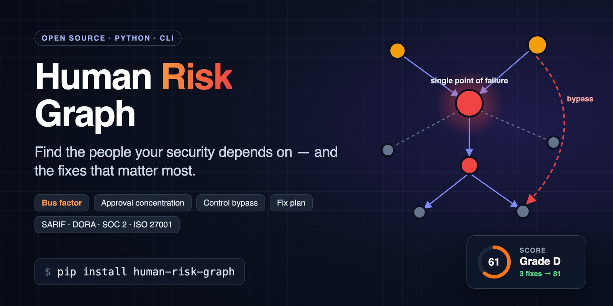
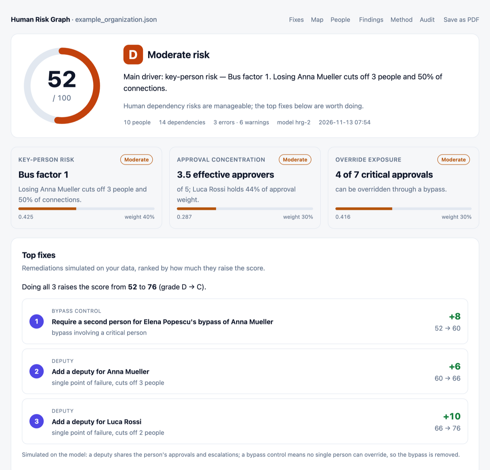

<p align="center">
  
</p>

<p align="center">
  <a href="https://pypi.org/project/human-risk-graph/"></a>
  <a href="https://pypi.org/project/human-risk-graph/"></a>
  <a href="https://pypistats.org/packages/human-risk-graph"></a>
  <a href="https://github.com/LF3551/human-risk-graph/actions/workflows/ci.yml"></a>
  <a href="https://codecov.io/gh/LF3551/human-risk-graph"></a>
  <a href="https://github.com/marketplace/actions/human-risk-graph"></a>
  <br>
  <a href="https://scorecard.dev/viewer/?uri=github.com/LF3551/human-risk-graph"></a>
  <a href="https://www.bestpractices.dev/projects/12048"></a>
  <a href="https://doi.org/10.5281/zenodo.18288055"></a>
  <a href="https://github.com/LF3551/human-risk-graph/blob/main/LICENSE"></a>
</p>

<p align="center">
  <a href="https://lf3551.github.io/human-risk-graph/"><b>Live demo</b></a> ·
  <a href="#quick-start">Quick start</a> ·
  <a href="#html-report">HTML report</a> ·
  <a href="#github-action">GitHub Action</a> ·
  <a href="docs/compliance.md">ISO 27001 · SOC 2 · DORA</a> ·
  <a href="docs/privacy.md">Privacy · GDPR</a> ·
  <a href="docs/validation-hrg3.md">Validation</a> ·
  <a href="docs/model.md">Model</a> ·
  <a href="https://doi.org/10.5281/zenodo.20260930">Paper</a>
</p>

# Human Risk Graph

**Your controls are only as strong as the people behind them.** Human Risk Graph maps who
approves, escalates to and can bypass whom, finds the people your organization cannot
afford to lose, and tells you **which three changes raise your score the most**.

- **One score, 0-100 and A-F**, from three metrics you can explain to a board: bus factor,
  effective number of approvers, and how many critical approvals can be bypassed.
- **A fix plan, not just a diagnosis**: deputies and second-person checks simulated on your
  data and ranked by score gain.
- **No YAML to start**: `hrg scan github` drafts the organization from one repository or
  a whole GitHub organization (who reviews, merges, releases, deploys and can bypass).
- **Stale authority**: people who can still merge, release or deploy but have not been
  active for 90 days are reported, with what the two-person rule is really left with.
- **Built for pipelines and audits**: SARIF for GitHub code scanning, JUnit, a `--min-score`
  gate, `hrg diff` between snapshots, findings mapped to ISO/IEC 27001, SOC 2 and DORA.
- **Privacy by design**: `--pseudonymize` replaces people by keyed pseudonyms in every
  report, for GDPR and works-council requirements; nothing leaves your machine.
- **Tested against outcomes**: in a [retrospective study](docs/validation-hrg3.md), with the
  protocol committed before data collection, a single releaser predicted which popular PyPI
  projects stopped releasing (4.8 times the rate).
- **A report you can hand over**: one offline HTML file with an interactive dependency map,
  readable on a phone and printable as PDF.

## Why

Simple ratios hide the worst cases. HRG is designed so that they cannot:

| Situation | Naive metric | Human Risk Graph |
|---|---|---|
| One person approves everything | "inequality 0" (nothing to compare) | 1.0 effective approvers, grade F |
| 99 people depend on one critical lead | 0.009 (diluted by headcount) | bus factor 1, same risk at any size |
| A critical approver can be bypassed | averaged away by good metrics | counted as an independent way to fail |

The model, its properties and its tests are in [docs/model.md](docs/model.md).

## Quick start

**See it first:** [live example reports](https://lf3551.github.io/human-risk-graph/) of three
fictional organizations, nothing to install.

Try it on the example organization, nothing to set up (needs [uv](https://docs.astral.sh/uv/)):

```bash
curl -sO https://raw.githubusercontent.com/LF3551/human-risk-graph/main/examples/organization.yaml
uvx --from human-risk-graph hrg analyze organization.yaml
open organization_report.html   # xdg-open on Linux
```

Or install it:

```bash
pip install human-risk-graph
hrg analyze my-org.yaml
```

```
Human Risk Graph 0.16.0 · organization.yaml · 5 people · 5 dependencies

  Score  25/100  ██░░░░░░░░  F · Critical risk  model hrg-2

  Key people  bus factor 1 · losing Alice cuts off 2 people (67% of connections)
  Approvals   1.5 effective approvers of 2 · Alice holds 77%
  Overrides   2 of 3 critical approvals can be overridden

  Top fixes
  1  Require a second person for Bob's bypass of Alice  25 → 45  +20
  2  Add a deputy for Alice                             45 → 71  +26
  3  Add a deputy for Bob                               71 → 76   +5

  Findings  3 errors · 2 warnings
   ▲ HRG001 Alice (alice) is a single point of failure (criticality 0.90): losing them cuts off 2 people
            and 67% of the connections between the others.
   ▲ HRG001 Bob (bob) is a single point of failure (criticality 0.70): losing them cuts off 1 person and
            50% of the connections between the others.
   ...
```

## Scan a GitHub repository

No YAML to write by hand: draft the organization from who actually reviews and merges code.

```bash
hrg scan github my-org/payments-api        # uses GITHUB_TOKEN, GH_TOKEN or `gh auth token`
hrg analyze payments-api-org.yaml
```

On GitHub Enterprise Server, add `--api-url https://github.example.com/api/v3` (the
GitHub CLI token for that host is used, and in GitHub Actions `GITHUB_API_URL` is picked up
automatically).

The scan reads the most recent merged pull requests (`--max-prs`, default 100) and turns
evidence into dependencies:

| Evidence | Dependency |
|---|---|
| Approving reviews by someone other than the author | `approval` reviewer → author |
| CODEOWNERS of the files a pull request changed (teams expanded when visible) | `approval` owner → author |
| A pull request merged without an approving review, on a branch that requires reviews | `bypass` merger → approvers |
| Ruleset bypass actors and branch protection allowances (when the token can see them) | `bypass` actor → approvers |

For model hrg-3 the scan also drafts functions: merge, release, admin, and deploy from the
repository's deployment environments ([below](#critical-functions-and-the-two-person-rule-hrg-3-experimental)).

Permissions and history do not prove real authority, so the draft is for a person to
review: every dependency carries `source`, `evidence` and `confirmed: false`, and reports
show how many are still unconfirmed. Set `confirmed: true` as you check them and adjust
`criticality`; running the scan again keeps your confirmations, criticality and the
dependencies you added by hand (approvals in Slack, escalations, on-call).

What the token cannot see (protection settings and bypass actors need admin access, team
members need org membership) is listed under `coverage.gaps` and shown in every report: a
bypass the scan did not find is not proof that none exists.

How well does this work? On 8 public CNCF repositories, 82% of approving reviews the scan
finds come from the approvers the projects declare in MAINTAINERS or OWNERS, and the most
active approver is a declared one in every repository; see the reproducible
[benchmark](docs/benchmark.md) and its limits.

Does the score predict anything? In a [retrospective study](docs/validation-hrg3.md) of 284
popular PyPI projects, with the protocol committed before data collection, those whose
releases were published by a single person before November 2024 stopped releasing in the
following year 4.8 times as often (95% CI 1.5–15.3) as those with two or more release
authors; a commit-based truck factor gave 1.9 (0.9–4.3).
Adjusted for release activity the ratio is 2.7 with an interval that includes 1, so part
of the effect is project activity.

```yaml
- from: lead
  to: dev
  type: bypass
  weight: 1.0
  source: merge-history+pr-reviews
  evidence: merged 3 PR(s) without an approving review (#812, #815, #820); also approved 4 of 9 merged PRs by dev
  confirmed: false
```

### A whole organization

One repository rarely shows the risk: the person who is the only releaser of one service is
often the only releaser of ten. Scan the most recently pushed repositories of an organization
into one draft:

```bash
hrg scan github --org my-org --max-repos 50     # archived repositories and forks are skipped
hrg analyze my-org-org.yaml --model hrg-3
```

People appear once, with the highest criticality any repository gave them. Dependencies
between the same two people are merged (a bypass in any repository outranks approvals; the
weight is the highest seen). The `merge`, `release`, `admin` and `deploy-*` functions stay
per repository (`payments-api/release`), so hrg-3 shows everything one person's absence stops
across the organization. Repositories that cannot be read are listed under
`coverage.gaps`; `--max-prs` (default 30 with `--org`) bounds the API calls per repository.

## Privacy: pseudonymized reports

HRG analyses identifiable people, so in the EU it processes personal data, and in Germany
it is typically a matter for the works council. `--pseudonymize` (or
`pseudonymize = true` in `hrg.toml`) replaces everyone by a keyed pseudonym in every
report and drops names, roles and evidence:

```bash
export HRG_PSEUDONYM_KEY=...      # secret, at least 16 characters; keeps pseudonyms stable
hrg analyze org.yaml --pseudonymize
hrg pseudonyms org.yaml           # pseudonym,id,name table for whoever holds the key
```

Pseudonyms are HMAC-SHA256 of the id with your key, so they cannot be reversed by trying
likely logins. HRG sends nothing anywhere and has no telemetry. What it processes, the
re-identification process and a deployment checklist (purpose, works council, DPIA) are in
[docs/privacy.md](docs/privacy.md).

## HTML report

One self-contained file that works offline, in light and dark mode, on a phone and as a PDF:
score and verdict, fix plan, interactive dependency map (for up to 400 people; `hrg visualize`
draws larger organizations), people, findings with related controls, the exact formula,
and an audit trail with the input file's SHA-256.
[Open a live example](https://lf3551.github.io/human-risk-graph/demo/platform-team.html).

<p align="center">
  <a href="https://lf3551.github.io/human-risk-graph/demo/platform-team.html"></a>
</p>

## What HRG measures

The score is built from three metrics (model `hrg-2`, see [docs/model.md](docs/model.md)):

- **Key-person risk** — how much of the organization depends on one person: losing them
  cuts off N people and X% of the connections between the others. Also reported as the
  classic **bus factor**.
- **Approval concentration** — the **effective number of approvers** (Herfindahl-Hirschman
  index): one person approving everything is as concentrated as it gets.
- **Override exposure** — the share of critical approvals someone can override through a
  bypass.

On top of the score, HRG simulates remediations (a deputy for a key person, a second-person
check on a bypass) and lists the three that raise the score most.

The original model from the paper is still available as `--model hrg-1`.

### Critical functions and the two-person rule (hrg-3, experimental)

Connections do not tell you who can **replace** someone. Model `hrg-3` works on the things
the organization must be able to do, such as merging to main, publishing a release,
changing repository settings or restoring the database. For each function it asks:

- **who can perform it, and what stops if one of them is unavailable** (function loss,
  availability sub-score);
- **can one person complete it alone** (solo control, integrity sub-score), the
  [SLSA Source Level 4](https://slsa.dev/spec/v1.2/source-requirements) two-party question.

```yaml
functions:
  - id: release
    criticality: 0.9
    requires: 1                 # 2 for a two-person rule
    performers: [alice, bob]
  - id: merge
    criticality: 0.8
    requires: 2
    performers: [alice, bob, carol]
    alone: [alice]              # can bypass the second person
  - id: restore-db
    criticality: 0.9
    separation: not-required    # one person restoring is the intended policy
    performers: [bob]
```

Not every critical operation needs two people. `separation: not-required` leaves a function
out of solo control and HRG006; it still counts as a single point of failure.

```bash
hrg analyze examples/functions.yaml --model hrg-3
```

`hrg scan github` drafts the `merge`, `release` and `admin` functions of a repository, and a
`deploy-<environment>` function for each deployment environment with required reviewers or
a production-like name (`production`, `pypi`, `release`, ...): who approves deployments,
whether they can approve their own, whether admins can bypass the rules, and who deployed
recently. A single-maintainer repository with no reviewers scores 100 under hrg-2 (there
are no dependencies to break) and 0 under hrg-3, because one person merges, releases and
administers alone. Definitions and properties: [docs/model-hrg3.md](docs/model-hrg3.md).

**Inactive people with authority.** The scan also records when each person who can perform
a function was last active (`last_active`: their latest merged pull request, approval,
release, deployment or commit). hrg-3 then reports people inactive for more than 90 days
(`--inactive-days`) as `HRG007`: the merge rule needs two reviewers but one of them left in
spring, or a dormant account can still publish releases alone. The score itself does not
change. Under the other models `hrg analyze` prints a one-line note when the file has
inactive people, pointing to `--model hrg-3`. `--no-activity` records no dates
([docs/privacy.md](docs/privacy.md)).

### What HRG is not

HRG models **authority**: who approves, who escalates to whom, and who can override a
control. It does not measure who **knows** the code. Tools that mine Git history, such as
[CodeScene](https://codescene.com) or [Busfactor](https://busfactor.tech), are better at
knowledge islands and code ownership; the two questions are complementary, since an
expert may not be allowed to approve a production change and an approver may not know
the system. HRG is also not an employee-behaviour or phishing-risk platform, and it is not
meant for judging how well people work: share pseudonymized reports beyond those who act on
the findings ([docs/privacy.md](docs/privacy.md)).

The score is a structural index, not the probability of an incident, and the fix plan
shows changes that improve the structure; whether a deputy can really do the job is for
you to judge. See [what the score means](docs/model.md#34-composite-risk-score-and-grade).

## Usage

### Installation

```bash
# Install from PyPI (recommended)
pip install human-risk-graph

# Or install from source
git clone https://github.com/LF3551/human-risk-graph.git
cd human-risk-graph
pip install -e .

# With development tools
pip install -e ".[dev]"
```

### Data Format

Describe your organization in a JSON or YAML file:

```json
{
  "$schema": "https://raw.githubusercontent.com/LF3551/human-risk-graph/main/src/human_risk_graph/organization.schema.json",
  "people": [
    { "id": "A", "role": "SRE", "criticality": 0.9 },
    { "id": "B", "role": "Security Engineer", "criticality": 0.8 },
    { "id": "C", "role": "Manager", "criticality": 0.7 },
    { "id": "D", "role": "Developer", "criticality": 0.4 }
  ],
  "dependencies": [
    { "from": "A", "to": "B", "type": "approval", "weight": 0.8 },
    { "from": "C", "to": "A", "type": "bypass", "weight": 0.9 }
  ]
}
```

**Fields:**
- `people.id` — unique identifier
- `people.role` — job title (optional)
- `people.criticality` — importance level (0.0-1.0)
- `people.last_active` — optional: date the person was last active (`2026-03-01`), or
  `never`; model hrg-3 reports inactive performers (HRG007)
- `dependencies.from/to` — person IDs
- `dependencies.type` — relationship type (approval, bypass, etc.)
- `dependencies.weight` — dependency strength (0.0-1.0)
- `dependencies.review` — for bypasses: `after` if every use is reviewed afterwards
  (break-glass). It still counts as an override, at half weight, and is labelled as such.
- `dependencies.confirmed` — `false` for dependencies nobody has checked yet (set by
  `hrg scan`). Reports then also show the score on confirmed dependencies only, so you can
  see how much the result depends on unverified data.

Invalid input (duplicate or unknown IDs, values outside 0.0-1.0) is rejected with an error
that points to the offending entry.

**YAML and editor support:** files ending in `.yaml` or `.yml` are read as YAML
(see [examples/organization.yaml](examples/organization.yaml)). The
[JSON Schema](src/human_risk_graph/organization.schema.json) gives completion and
validation in editors: reference it with `"$schema"` in JSON, or with
`# yaml-language-server: $schema=<url>` at the top of a YAML file.
`hrg schema` prints the schema.

### CLI Usage

The easiest way to use HRG is through the command-line interface:

```bash
# Analyze an organization (generates JSON, Markdown, and HTML reports)
hrg analyze data/example_organization.json

# Generate only HTML report
hrg analyze data/example_organization.json --format html

# Specify output file
hrg analyze data/example_organization.json --format html --output my_report.html

# CI: SARIF and JUnit reports, fail if the score is below 70
hrg analyze examples/organization.yaml --format sarif --format junit --no-visualize --min-score 70

# Compare two snapshots (text, markdown or json)
hrg diff org-q1.yaml org-q2.yaml --format markdown

# Reports with keyed pseudonyms instead of people (docs/privacy.md)
HRG_PSEUDONYM_KEY=... hrg analyze org.yaml --pseudonymize

# Original model from the paper, no fix plan, only errors
hrg analyze data/example_organization.json --model hrg-1 --fixes 0 --quiet

# Generate interactive graph visualization only
hrg visualize data/example_organization.json
```

Exit codes: `0` success, `1` invalid input or error, `2` usage error,
`3` score below `--min-score`, composite risk above `--fail-above`, or risk increased with
`hrg diff --fail-on-increase`.

Each run writes the reports next to the input file: JSON (all results, findings and the fix
plan), Markdown, the HTML report, and with `--visualize` (default) a standalone interactive
graph.

### Configuration and risk acceptance

Put the settings your team agreed on in `hrg.toml` (or `[tool.hrg]` in `pyproject.toml`)
next to where you run `hrg`; options on the command line win. When a finding is a
conscious decision, record it as an **accepted risk** with a reason, a ticket and an
expiry date instead of lowering the bar for everyone:

```toml
min-score = 70
inactive-days = 90   # optional, hrg-3: report people with authority inactive for longer
pseudonymize = true  # optional: keyed pseudonyms in every report (key in HRG_PSEUDONYM_KEY)

[weights]            # optional, must add up to 1
key-person = 0.4
concentration = 0.3
override = 0.3

[[accept]]
rule = "HRG003"
target = "bob->alice"          # a person ID, "from->to" for bypasses, or omit for the whole rule
reason = "Break-glass access for incidents; every use is reviewed by the CISO"
ticket = "SEC-123"
expires = 2027-06-30
```

Accepted findings stay visible but do not fail CI: they are listed under *Accepted risks*
in the reports, marked as suppressed (with the justification) in SARIF, and reported as
passed in JUnit. When `expires` passes, the finding counts again and `hrg` says so. An
acceptance that no longer matches anything is reported as safe to remove. See
[examples/hrg.toml](examples/hrg.toml).

### Findings and Compliance Mapping

Every finding has a rule ID (`HRG001` single point of failure, `HRG002` concentrated
approval authority, `HRG003` bypass involving a critical person, `HRG004` risk above
threshold; with `--model hrg-3` also `HRG005` function depends on too few people,
`HRG006` critical function one person can complete alone and `HRG007` function relies on
inactive people) and related controls in
ISO/IEC 27001:2022, SOC 2 and DORA. The mapping is informative, not a compliance
assessment. See [docs/compliance.md](docs/compliance.md).

### CI integration

#### GitHub Action

Analyze an organization file on every pull request that changes it: findings appear as
code scanning alerts on the file, the job summary shows the score, metrics, findings and
top fixes, the HTML report is attached as an artifact, and the job fails below 70.
Accepted risks in `hrg.toml` are honoured.

```yaml
name: Human risk
on:
  pull_request:
    paths: [org/organization.yaml, hrg.toml]
permissions:
  contents: read
  security-events: write   # for the code scanning upload
jobs:
  hrg:
    runs-on: ubuntu-latest
    steps:
      - uses: actions/checkout@v7
      - uses: LF3551/human-risk-graph@v0.16.0
        with:
          file: org/organization.yaml
          min-score: 70
```

Or draft the organization from the repository itself (approvals, CODEOWNERS, branch
rules) and report on it, for example on a schedule:

```yaml
      - uses: LF3551/human-risk-graph@v0.16.0
        with:
          scan: ${{ github.repository }}
```

Or the whole organization, with pseudonymized reports (the draft with real logins is then
not uploaded):

```yaml
      - uses: LF3551/human-risk-graph@v0.16.0
        env:
          HRG_PSEUDONYM_KEY: ${{ secrets.HRG_PSEUDONYM_KEY }}
        with:
          scan-org: my-org
          token: ${{ secrets.HRG_ORG_TOKEN }}   # read access to the organization's repositories
          pseudonymize: true
```

| Input | Default | Description |
|---|---|---|
| `file` | | Organization file to analyze (set one of `file`, `scan`, `scan-org`) |
| `scan` | | `OWNER/REPO` to draft with `hrg scan github` first |
| `scan-org` | | Organization (or user) to draft with `hrg scan github --org` first |
| `max-repos` | `30` | With `scan-org`: repositories to scan |
| `max-prs` | `100` (`30` with `scan-org`) | Merged pull requests to read per repository |
| `pseudonymize` | `false` | Keyed pseudonyms instead of people (key in `HRG_PSEUDONYM_KEY`) |
| `model` | config, else `hrg-2` | `hrg-3` scores critical functions: merge, release, admin, deploy |
| `inactive-days` | config, else `90` | With `hrg-3`: report people with authority inactive for longer (HRG007) |
| `token` | `github.token` | Token for `scan` and `scan-org` |
| `api-url` | `github.api_url` | GitHub API for `scan` and `scan-org`; GitHub Enterprise Server works without setting it |
| `config` | auto | `hrg.toml`, `.hrg.toml` or `[tool.hrg]` in `pyproject.toml` |
| `min-score` / `fail-above` | | Fail below this score (0-100) / above this risk (0-1) |
| `upload-sarif` | `true` | Upload findings to code scanning (with `file`) |
| `upload-artifact` | `true` | Upload the HTML, Markdown, JSON and SARIF reports |
| `output-dir` | `hrg-report` | Where the reports are written |
| `python-version` / `version` | `3.12` / this action's | Python and human-risk-graph versions |

Outputs: `score`, `grade`, `risk-level`, `errors`, `warnings`, `report-dir`, `sarif-file`.
When a threshold is broken, the reports are still published and the last step fails.

#### Other CI systems

```bash
pip install human-risk-graph
hrg analyze org/organization.yaml --format sarif --format junit --no-visualize --min-score 70
```

The JUnit report (`org/organization_report.junit.xml`) has one test case per rule and
works with any CI system that shows test results. To show what a change does to the
scores, compare against the base branch:

```bash
git show origin/main:org/organization.yaml > /tmp/base.yaml
hrg diff /tmp/base.yaml org/organization.yaml --format markdown >> "$GITHUB_STEP_SUMMARY"
```

### Python API Usage

```python
from human_risk_graph import HumanRiskGraph

# Load your organization data
people = [...]
dependencies = [...]

# Create and analyze
hrg = HumanRiskGraph(people, dependencies)
results = hrg.calculate()  # model="hrg-1" for the original model

print(f"Score: {results['score']}/100 ({results['grade']}, {results['risk_level']} risk)")
print(f"Bus factor: {results['bus_factor_people']}")
print(f"Effective approvers: {results['effective_approvers']:.1f}")

for fix in hrg.fix_plan():
    print(f"{fix['title']}: {fix['score_before']} -> {fix['score_after']}")
```

## Development

- `src/human_risk_graph/` — the package (model, CLI, reports)
- `tests/` — unit, property and CLI tests
- `docs/` — formal model, compliance mapping, privacy, benchmark and validation study
- `benchmark/` — scanner benchmark and the validation study (code, data, results)
- `examples/`, `data/` — example organizations and generated reports
- `experiments/` — synthetic data and benchmarks from the paper
- `paper/` — LaTeX source of the [paper](https://doi.org/10.5281/zenodo.20260930)

```bash
# Run tests
pytest tests/ -v

# Run tests with coverage
pytest tests/ --cov=human_risk_graph --cov-report=html

# Code formatting
black src/ tests/ --line-length 100

# Linting
flake8 src/ tests/

# Run experiments (needs: pip install "human-risk-graph[experiments]")
python experiments/generate_data.py
python experiments/run_experiments.py
python experiments/visualize.py
```

## Use Cases

**Best suited for:** Organizations with 50+ employees, formal security processes, or compliance requirements.

- Security architecture analysis
- Business continuity planning (SOC 2, ISO/IEC 27001 audits)
- Insider threat assessment
- M&A due diligence (key person risk)
- Organizational risk modeling

**Note:** For small teams (<20 people), managers typically have direct visibility into dependencies. 
HRG provides the most value when organizational complexity exceeds intuitive understanding.

## Status

HRG is in beta (0.x): the metrics and the input format may still change between minor
releases. Scores support risk discussions and audits; they do not replace a full
risk assessment.

## Citation

If you use this software in your research or work, please cite:

```bibtex
@software{aleinikov_2026_hrg,
  author       = {Aleinikov, Aleksei},
  title        = {Human Risk Graph: A Quantitative Model for Organizational Security Risk},
  year         = 2026,
  publisher    = {Zenodo},
  doi          = {10.5281/zenodo.18288055},
  url          = {https://doi.org/10.5281/zenodo.18288055}
}
```

Or use this text citation:

> Aleinikov, A. (2026). Human Risk Graph: A Quantitative Model for Organizational Security Risk. Zenodo. https://doi.org/10.5281/zenodo.18288055

The DOI above always resolves to the latest release; each release also gets its own version DOI on [Zenodo](https://doi.org/10.5281/zenodo.18288055).

To cite the model itself, use the paper:

```bibtex
@article{aleinikov_2026_hrg_paper,
  author       = {Aleinikov, Aleksei},
  title        = {Human Risk Graph: A Quantitative Model for Organizational Security Risk},
  year         = 2026,
  publisher    = {Zenodo},
  doi          = {10.5281/zenodo.20260930},
  url          = {https://doi.org/10.5281/zenodo.20260930}
}
```

## License

Licensed under the Apache License, Version 2.0.
See the LICENSE file for details.
